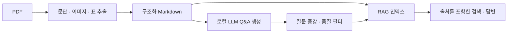

# Deep Doc Extractor — 문서에서 학습 데이터와 RAG까지

PDF 기술 문서를 구조화된 Markdown으로 추출하고, 로컬 LLM으로 Q&A 데이터를 생성·증강한 뒤 RAG 검색으로 확인하는 우송대학교 캡스톤 프로젝트입니다.

## 해결하려던 문제

기술 매뉴얼에는 문단·표·이미지가 함께 들어 있습니다. 문서를 텍스트로만 바꾸면 출처와 구조가 사라지고, 생성한 질문·답변이 원문에 근거하는지도 확인하기 어렵습니다. 추출, 생성, 품질 필터, 검색 확인을 단계별로 나눠 처리 결과를 추적하도록 설계했습니다.

## 처리 흐름



| 단계 | 구현 내용 | 기술 |
| --- | --- | --- |
| 문서 추출 | 텍스트·표·이미지를 분리하고 Markdown으로 구성 | pdfplumber, Camelot |
| Q&A 생성 | 문서를 청크로 나누고 질문·답변과 출처를 저장 | Ollama, JSONL |
| 데이터 증강 | 답변을 유지하며 질문을 재표현하고 중복·의미 이탈을 필터링 | 임베딩 유사도, 품질 필터 |
| RAG 확인 | 문서·Q&A를 검색하고 근거를 붙여 답변 | ChromaDB, Streamlit |

## 설계와 문제 해결

- **출처 추적:** Q&A와 검색 결과에 문서·페이지·구간 정보를 연결합니다.
- **단계별 재실행:** `pipeline.py`와 `config.yaml`에서 입력·모델·출력 경로를 관리해 필요한 단계만 실행합니다.
- **증강 품질 관리:** 질문을 늘리는 과정에서 동일 표현과 의미가 벗어난 후보를 구분하고 거절 결과를 기록합니다.
- **검색 근거가 없는 답변 제어:** RAG에서 충분한 검색 결과가 없으면 답변을 거절하는 흐름을 둡니다.

## 검증과 한계

직접 작성한 예제 PDF의 문서 추출과 Stage 3·4 오프라인 구성 요소 검사를 제공합니다. [검증 기록](docs/PUBLIC_VALIDATION.md)에서 범위를 확인할 수 있습니다. 실제 모델의 전체 생성 품질·검색 정확도·처리 속도는 별도 평가 대상입니다. 스캔 PDF OCR은 현재 기본 설정에서 비활성화되어 있습니다.

## 실행

Python 3.11과 Ollama를 준비합니다. 모델·의존성 최초 설치에는 인터넷 연결이 필요합니다.

```bash
git clone https://github.com/choisung-ho/deep-doc-extractor.git
cd deep-doc-extractor
python3 -m venv .venv
source .venv/bin/activate
python -m pip install -r requirements.txt
```

`config.yaml`에 사용할 Ollama 모델을 지정하고 동일한 모델을 로컬에 준비합니다. 기본 모델은 `qwen3.5:9b`입니다.

```bash
python examples/create_sample_pdf.py
python pipeline.py --stage 1 --config config.yaml
python pipeline.py --stage 2 --config config.yaml
python pipeline.py --stage 3 --config config.yaml
python pipeline.py --stage 4 --config config.yaml
streamlit run stage4/streamlit_app.py
```

본인 PDF를 사용하려면 `input.pdf_path`를 변경합니다. `--stage all-rag`는 전체 파이프라인을 실행합니다.

## 자료와 출처

- [Stage 3](stage3/README.md), [Stage 4](stage4/README.md), [평가 도구](evaluation/README.md)
- 기존 Team DocuForge 표기와 [MIT License](LICENSE)의 저작권 고지를 보존합니다.
- 원본 업무 매뉴얼, 생성 데이터셋과 모델 가중치는 포함하지 않습니다. `examples/`는 직접 작성한 합성 예제입니다.
