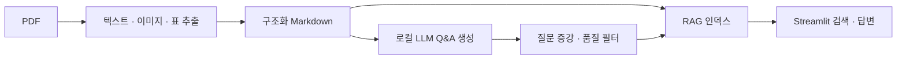

# Deep Doc Extractor

PDF 기술 문서를 구조화된 Markdown으로 추출하고, 로컬 LLM으로 학습용 Q&A 데이터를 생성·증강한 뒤 RAG 검색으로 확인하는 문서 처리 파이프라인입니다.

우송대학교 캡스톤 프로젝트의 공개용 소스입니다. 기존 코드의 Team DocuForge 표기와 MIT 라이선스의 저작권 고지를 유지합니다. 구체적인 개인 기여 범위는 이 저장소에서 확정하지 않습니다.

## 처리 흐름

| 단계 | 입력 → 출력 | 주요 구성 |
| --- | --- | --- |
| 1. 문서 추출 | PDF → Markdown·이미지·표 | pdfplumber, Camelot |
| 2. Q&A 생성 | Markdown → 출처를 포함한 JSONL | Ollama, 청킹, 품질 필터 |
| 3. 데이터 증강 | Q&A → 질문 변형 데이터 | 재표현, 유사도·중복 필터 |
| 4. RAG 확인 | 문서·Q&A → 검색과 답변 | ChromaDB, 임베딩, Streamlit |



## 설치

Python 3.11을 권장합니다. Q&A 생성과 답변에는 Ollama가 필요합니다. 모델·패키지 최초 설치에는 인터넷 연결이 필요하며, 설치 이후의 로컬 처리와 별개입니다.

```bash
git clone https://github.com/choisung-ho/deep-doc-extractor.git
cd deep-doc-extractor
python3 -m venv .venv
source .venv/bin/activate
python -m pip install -r requirements.txt
```

Ollama를 설치한 뒤 `config.yaml`의 `stage2.llm.model`, `stage3.llm.model`, `stage4.llm.model`에 사용할 모델을 지정합니다. 기본 설정은 `qwen3.5:9b`이며, 동일한 모델을 Ollama에 준비해야 합니다. 모델 실행에는 충분한 메모리가 필요합니다.

## 예제와 실행

실제 업무 매뉴얼은 포함하지 않습니다. 저장소에 있는 직접 작성한 예제 문서로 시작할 수 있습니다.

```bash
python examples/create_sample_pdf.py
python pipeline.py --stage 1 --config config.yaml
python pipeline.py --stage 2 --config config.yaml
python pipeline.py --stage 3 --config config.yaml
python pipeline.py --stage 4 --config config.yaml
streamlit run stage4/streamlit_app.py
```

`config.yaml`의 `input.pdf_path`를 본인 PDF 경로로 바꾸면 다른 문서를 처리할 수 있습니다. `--stage all-rag`로 전체 단계를 실행할 수도 있습니다. 이미지 기반 스캔 PDF의 OCR은 현재 설정에서 비활성화되어 있습니다.

## 검증

```bash
python stage3/test_stage3.py
python stage4/test_stage4.py
```

위 검사는 외부 LLM을 호출하지 않는 구성 요소 확인입니다. 실제 모델을 사용하는 전체 생성·검색 품질 평가와는 구분됩니다. 원래 소개 문서에 있던 성능 수치는 평가 결과 원본을 함께 확인하지 못했으므로 공개 README에 확정 수치로 싣지 않았습니다.

## 구성

- `pipeline.py`: 단계별 실행 진입점
- `config.yaml`: 입력·모델·출력·필터 설정
- `stage1/`–`stage4/`: 각 처리 단계
- `evaluation/`: 품질 평가 도구
- `examples/`: 직접 작성한 예제와 PDF 생성 도구
- [Stage 3 안내](stage3/README.md), [Stage 4 안내](stage4/README.md)

## 공개 범위와 라이선스

원본 매뉴얼, 추출된 실제 문서, 생성 데이터셋, 모델 가중치, 개인 설정은 제외했습니다. 기존 [MIT License](LICENSE)의 `Copyright (c) 2026 JubayerRafin` 고지를 보존합니다.

공개 준비 시 실행한 검사와 범위는 [검증 기록](docs/PUBLIC_VALIDATION.md)에 정리했습니다.
